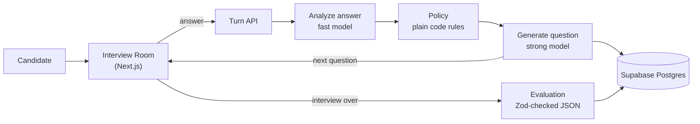

# AI Interviewer Platform

Pick a job, talk to an AI interviewer, and get a transcript and structured feedback at the end. The interviewer asks questions grounded in the role and follows up on what you actually said.

- **Live demo:** <https://ai-interviewer-cyan-three.vercel.app> · demo password: `"P@ssw0rd-!@#"` (this is a private repo made for the take-home, so it is written here on purpose)
- **Status:** all requirements and stretch goals are built. A few checks need a human, see [feature status](#feature-status).

## How it works

Plain code decides what happens next (a follow-up, a new question from the role's question bank, or wrapping up), and the language model only writes the words and scores the result. That keeps the interview auditable: every question comes with the reason it was chosen.



Hard rules enforced by the policy: at least 6 questions, **at least 2 follow-ups that quote the candidate's previous answer**, and no wrapping up before both are met. Details are in the [interview engine](docs/interview-engine.md) doc.

## Quick start

Requirements: Node 20 or newer and a Postgres database (a Supabase project, or `docker compose up -d db` locally).

```bash
npm install
cp .env.example .env     # fill in the keys, see docs/setup.md
npm run db:migrate
npm run db:seed
npm run dev              # http://localhost:3000
```

No vendor keys yet? Set `USE_FAKES=1` and a local `DATABASE_URL` to run the whole app against deterministic fakes.

## Deploy

`npm run deploy` migrates the database, syncs the environment variables and ships to production in one go. See [setup](docs/setup.md#deploying-to-vercel).

## Tests

```bash
npm run test:unit          # pure logic, including randomized interviews
npm run test:integration   # services and API routes against a real Postgres
npm run test:e2e           # Playwright: browser, built app, fake vendors
npm run lint && npm run typecheck && npm run docs:check
```

CI runs all of these on every push. See [testing](docs/testing.md).

## Feature status

| Area                                                                               | Status                                                                                                                                                                   |
| ---------------------------------------------------------------------------------- | ------------------------------------------------------------------------------------------------------------------------------------------------------------------------ |
| Job list with at least 3 roles                                                     | Done                                                                                                                                                                     |
| Interview Room with role-grounded questions, 6+ questions, 2+ dependent follow-ups | Done                                                                                                                                                                     |
| Session saved, transcript and structured evaluation at the end                     | Done                                                                                                                                                                     |
| Voice input and spoken questions (ElevenLabs Scribe v2 Realtime and Flash)         | Done. Verified with the real services using a simulated microphone. **Checking pauses and accents with a real voice is still a human step.** Typing is always available. |
| Stretch 1: decision panel                                                          | Done                                                                                                                                                                     |
| Stretch 2: job-specific question packs                                             | Done (8 topics per role, behavioral and technical)                                                                                                                       |
| Stretch 3: video mode and compressed recording                                     | Done (call layout, optional camera, consent, size-capped upload). Not yet checked in Safari.                                                                             |
| Stretch 4: history, replay and analytics                                           | Done (`/history`, replay, duration, talk ratio, topic coverage, score trend)                                                                                             |
| Capacity gate and wait queue (max 4 at once)                                       | Done                                                                                                                                                                     |
| ElevenLabs Agents transport                                                        | Experimental and parked, see [decision 0005](docs/adr/0005-turn-taking-in-the-browser.md)                                                                                |
| Loom walkthrough                                                                   | Pending (human step)                                                                                                                                                     |

## Documentation

| Page                                                       | What it covers                                                                       |
| ---------------------------------------------------------- | ------------------------------------------------------------------------------------ |
| [Plan and progress checklist](docs/plan-ai-interviewer.md) | The full plan, decisions, blockers and the checklist this project is tracked against |
| [Architecture](docs/architecture.md)                       | System overview, one turn, access control, recordings, and the deployment view       |
| [Interview engine](docs/interview-engine.md)               | State machine, policy rules, model steps and the decision panel                      |
| [Data model](docs/data-model.md)                           | Tables, relationships and status fields                                              |
| [Voice pipeline](docs/voice-pipeline.md)                   | Speech in and out, turn-taking rules, latency and fallbacks                          |
| [Capacity queue](docs/capacity-queue.md)                   | The 4-at-a-time gate, waiting room, promotion and expiry                             |
| [Recording storage](docs/recording-storage.md)             | Compression, storage budget and oldest-first deletion                                |
| [History and replay](docs/history-and-replay.md)           | History page, replay and how metrics are computed                                    |
| [Decision records](docs/adr/README.md)                     | Short records of the key decisions and tradeoffs                                     |
| [Testing](docs/testing.md)                                 | Test levels, the fakes, live tests and how to run everything                         |
| [Setup](docs/setup.md)                                     | Accounts, environment variables, local development and deployment                    |
