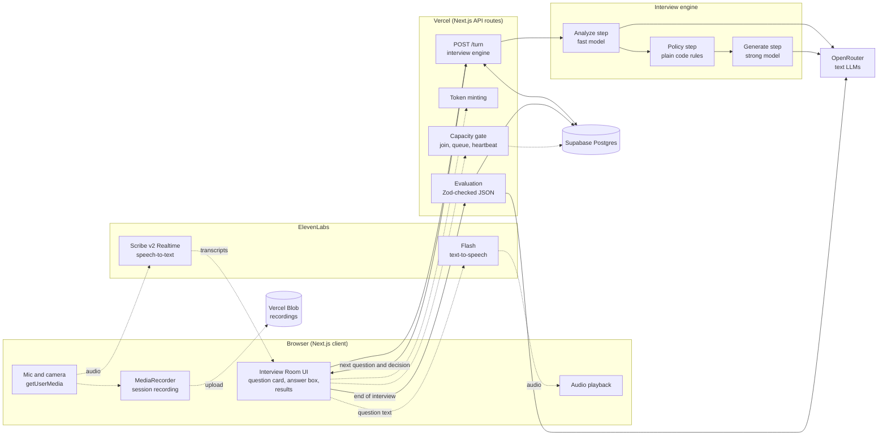
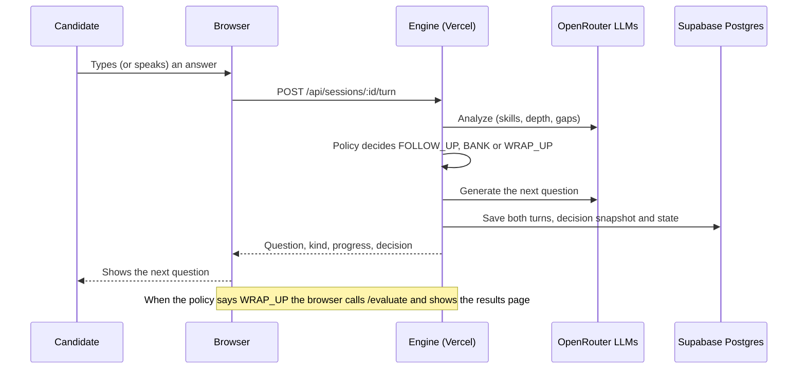
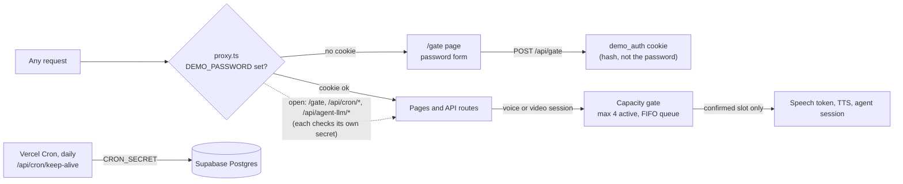
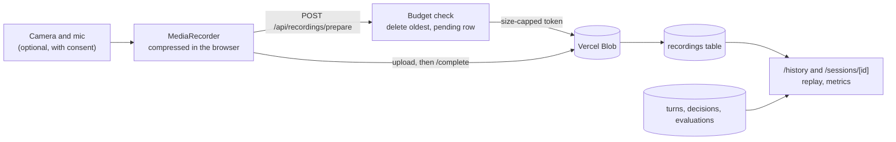
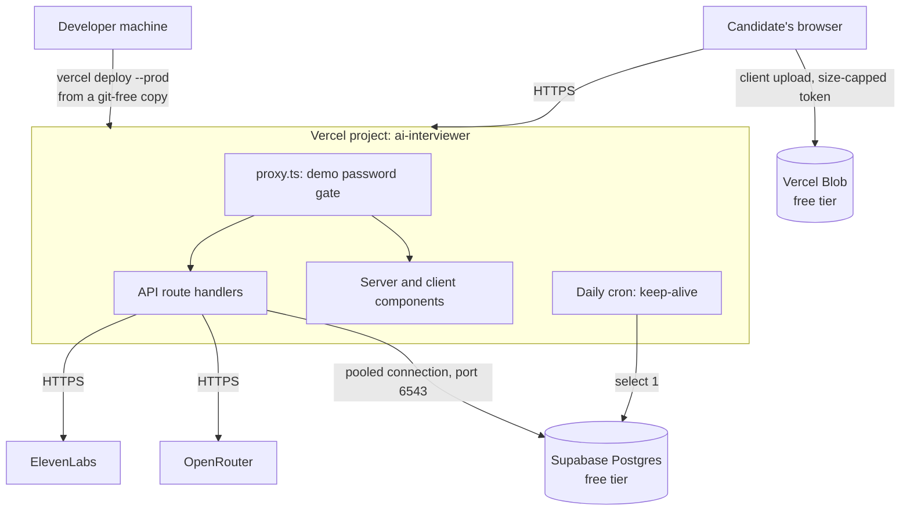

# Architecture

[Back to the README](../README.md) · Related: [interview engine](interview-engine.md), [data model](data-model.md), [capacity queue](capacity-queue.md), [recording storage](recording-storage.md), [history and replay](history-and-replay.md), [voice pipeline](voice-pipeline.md), [testing](testing.md), [setup](setup.md), [decision records](adr/README.md)

AI Interviewer is one Next.js app on Vercel. Server routes keep every API key private, Supabase Postgres stores the data, and the interviewer's decisions are made by plain code in a server-side engine. The language model only writes the words and scores the result.

## System overview

Solid arrows are the base plan. Dashed arrows are features added in later milestones (recordings, and the optional ElevenLabs Agents transport).

## One turn, step by step

## Access control and capacity

See [capacity queue](capacity-queue.md) for the join, heartbeat and promotion flow.

## Recordings, history and replay

Details: [recording storage](recording-storage.md) and [history and replay](history-and-replay.md).

## Deployment view

Production: <https://ai-interviewer-cyan-three.vercel.app> (Vercel project `ai-interviewer`, protected by the demo password, which is shared separately).

The app is deployed from a copy of the project **without `.git`**. Vercel Hobby blocks deployments whose git metadata points at a GitHub organisation repository (here `AQ-Assessment`), so attaching no git metadata is what lets the deploy through. See [setup](setup.md).

## Key decisions

- **Plain code decides, the model writes.** The follow-up rules, question limits and topic choice are deterministic and tested. See [interview-engine.md](interview-engine.md).
- **Ports and adapters.** The engine depends on small interfaces in `lib/ports` (language model, speech, blob storage, clock). Real adapters and deterministic fakes implement them, so tests run without any vendor.
- **Validated boundaries.** Zod validates environment variables, every request body, and every model response.
- **Serverless friendly.** Database access uses the pooled connection with prepared statements disabled, and a tiny connection pool.
