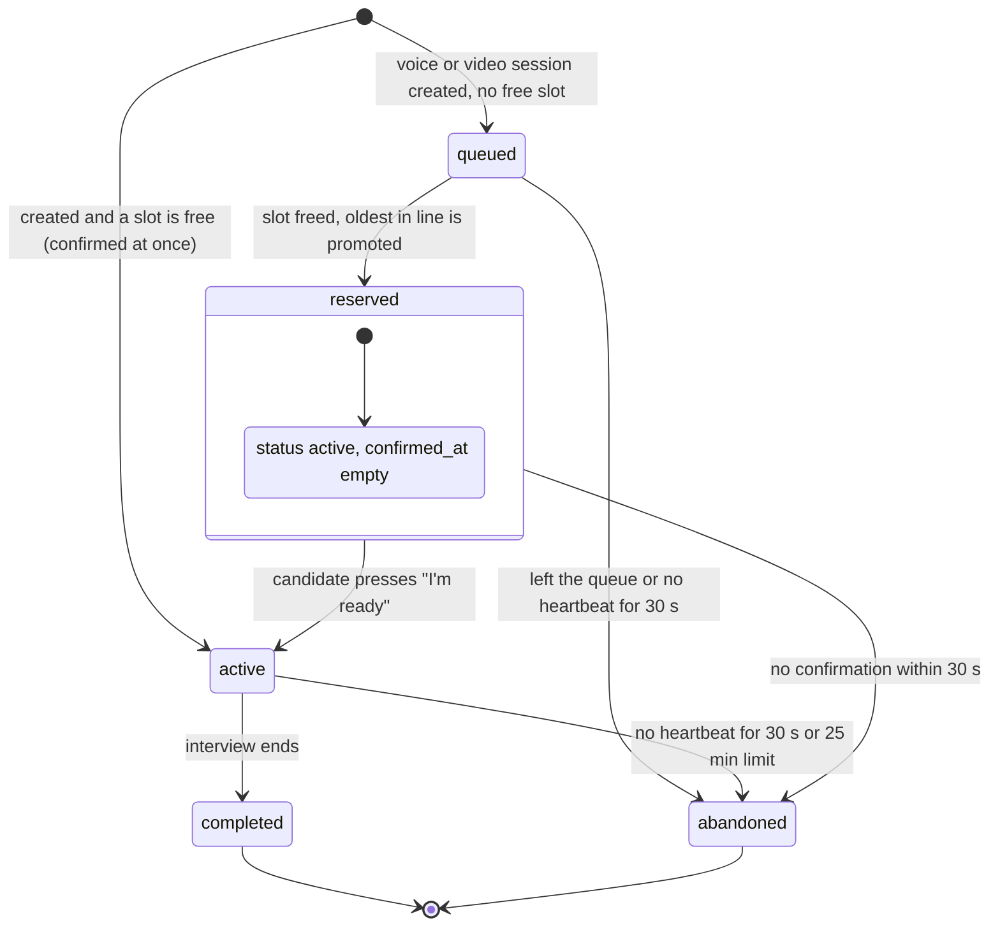
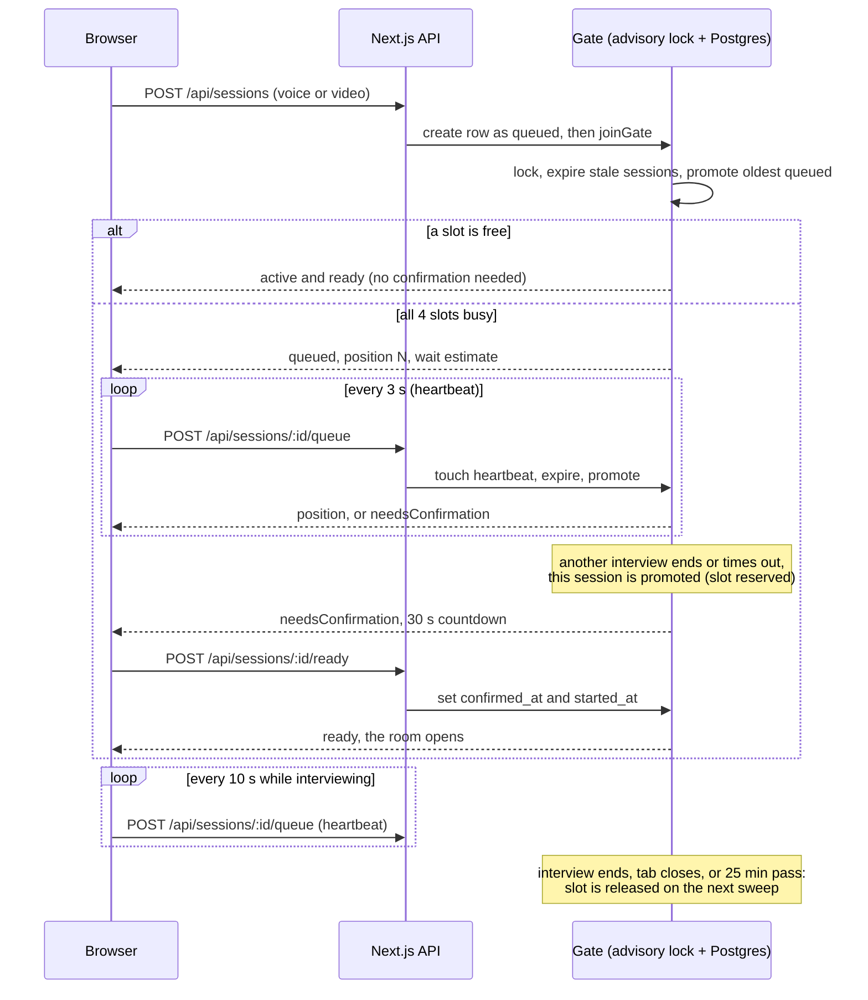

# Capacity gate and wait queue

[Back to the README](../README.md) · Related: [architecture](architecture.md), [data model](data-model.md), [voice pipeline](voice-pipeline.md), [decision record](adr/0006-capacity-gate.md)

ElevenLabs charges extra above the plan's concurrent-call limit (4 on the free plan), so the app never runs more than **4 voice or video interviews at once**. Everyone else waits in a first-in, first-out queue. The logic is pure code in `lib/queue/policy.ts` and the transactional service in `lib/queue/service.ts`.

## Session status

"Reserved" is not a separate enum value: it is `status = active` with `confirmed_at` still empty. It counts against the limit, but the candidate cannot interview or get speech tokens until they confirm.

## Join, wait, promote, confirm

## Rules

| Rule                  | Value                                                                                                                                               | Where                            |
| --------------------- | --------------------------------------------------------------------------------------------------------------------------------------------------- | -------------------------------- |
| Concurrent interviews | 4 (`MAX_CONCURRENT_INTERVIEWS`)                                                                                                                     | `queueConfigFromEnv`             |
| Queue order           | FIFO by `queued_at`, ties by id                                                                                                                     | `byQueueOrder`                   |
| Heartbeat timeout     | 30 s without a poll frees the place (closed tab, crash)                                                                                             | `findExpired`                    |
| Confirmation window   | 30 s after promotion, then the next in line gets the slot                                                                                           | `findExpired`                    |
| Maximum duration      | 25 minutes (`MAX_SESSION_MINUTES`)                                                                                                                  | `findExpired`                    |
| Text interviews       | Bypass the gate: no speech services, no slot                                                                                                        | `createAndJoin`, `gated()` query |
| Enforcement           | `startInterview`, `submitTurn`, the speech token, agent session and `/tts` routes reject queued or unconfirmed sessions with `409 waiting_for_slot` | `assertRunnable`                 |
| Races                 | One Postgres advisory lock (`pg_advisory_xact_lock`) serialises join, promote and expire, so concurrent joins can never exceed the limit            | `withGate`                       |
| No cron needed        | Every join and poll sweeps expired sessions first                                                                                                   | `sweepAndPromote`                |

A candidate who joins and finds a free slot (including one handed out a moment earlier by a concurrent join) is confirmed immediately, because nobody was waiting. Only people who waited must confirm.

## Waiting room

`components/interview/waiting-room.tsx` shows "You are #N in line" with a rough wait (waves of 4 interviews of about 10 minutes), a "Leave the queue" button, and the "I'm ready" confirmation with its countdown. No microphone or camera access is requested until the slot is confirmed. If the place expires, the page says so and links back to the roles.

## Tests

`tests/unit/queue-policy.test.ts` covers the pure rules. `tests/integration/capacity.test.ts` runs against real Postgres: 10 concurrent joins give exactly 4 active and 6 queued in order, text bypass, promotion and confirmation, confirmation timeout, heartbeat expiry, maximum duration, leaving, token enforcement, and the HTTP routes.
