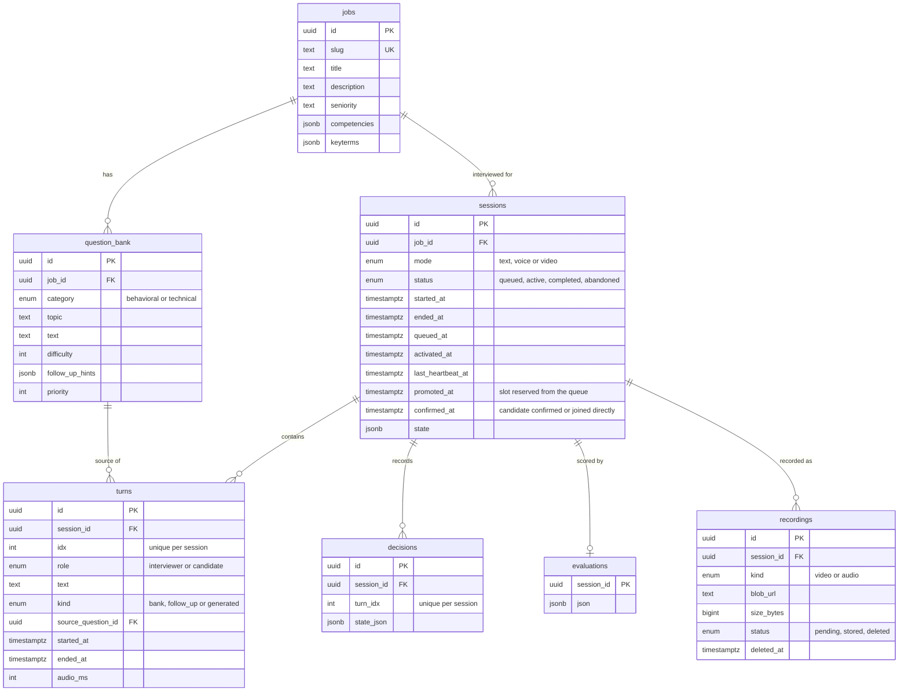

# Data model

[Back to the README](../README.md) · Related: [architecture](architecture.md), [interview engine](interview-engine.md)

Postgres on Supabase, accessed with Drizzle. The schema lives in `lib/db/schema.ts` and the SQL migrations in `drizzle/`.

## Status fields

| Field                   | Values                   | Meaning                                                                                                                       |
| ----------------------- | ------------------------ | ----------------------------------------------------------------------------------------------------------------------------- |
| `sessions.status`       | `queued`                 | Waiting for a free interview slot ([capacity queue](capacity-queue.md)).                                                      |
|                         | `active`                 | The candidate holds a slot. They may answer questions only once `confirmed_at` is set.                                        |
|                         | `completed`              | The interview ended normally and can be evaluated.                                                                            |
|                         | `abandoned`              | The candidate left or stopped responding.                                                                                     |
| `sessions.mode`         | `text`, `voice`, `video` | How the candidate answers. Text is always available as a fallback.                                                            |
| `turns.kind`            | `bank`                   | A question from the role's question bank, possibly lightly rephrased.                                                         |
|                         | `follow_up`              | A question that builds on the previous answer.                                                                                |
|                         | `generated`              | Other interviewer text, such as the closing message.                                                                          |
| `recordings.status`     | `pending`                | Reserved by `/api/recordings/prepare` and counted against the storage budget until upload completes (stale after 15 minutes). |
|                         | `stored`                 | Uploaded to Vercel Blob; `blob_url` and the real `size_bytes` are set.                                                        |
|                         | `deleted`                | Removed from Blob to stay under the budget (oldest first); the row stays so the UI can say so.                                |
| `sessions.promoted_at`  | timestamp                | When a queued session was given a slot and had to confirm.                                                                    |
| `sessions.confirmed_at` | timestamp                | When the candidate confirmed, or when a direct join started the interview. Interviews and speech tokens need it.              |

## What is kept

Transcripts, decision snapshots and evaluations are small and stay in Postgres indefinitely. Only recordings are rotated by the storage budget rules ([recording storage](recording-storage.md)); the replay and metrics pages read them ([history and replay](history-and-replay.md)).

## Seeds

`lib/seed` defines three roles (Frontend Engineer, Data Analyst, Customer Success Manager) with 8 topics each and one behavioral and one technical question per topic, with follow-up hints. Rows have deterministic IDs, so re-seeding updates them in place instead of orphaning turn references. Run it with `npm run db:seed`.
