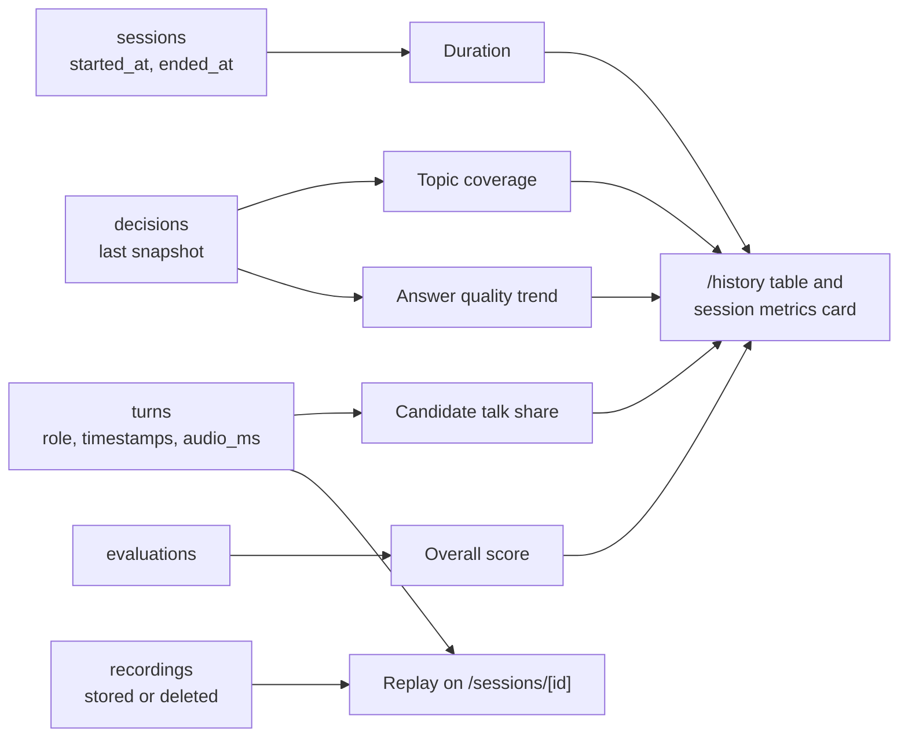

# History and replay

[Back to the README](../README.md) · Related: [data model](data-model.md), [interview engine](interview-engine.md)

`/history` lists past sessions with per-session metrics, and `/sessions/[id]` can replay a session's recording next to its transcript. All metrics are computed from data kept in Postgres (turns, decision snapshots, evaluation), so they keep working after a recording is deleted by the storage rules.

## Metrics

| Metric               | Definition (`lib/analytics/metrics.ts`)                                                                                                                                                                                      |
| -------------------- | ---------------------------------------------------------------------------------------------------------------------------------------------------------------------------------------------------------------------------- |
| Duration             | `ended_at` minus `started_at` of the session. Empty while the interview is running.                                                                                                                                          |
| Candidate talk share | Candidate speaking time divided by candidate plus interviewer speaking time. Per turn: `audio_ms` if recorded, else the turn's `ended_at` minus `started_at`, else an estimate from word count (about 150 words per minute). |
| Topic coverage       | Topics covered in the last decision snapshot divided by the role's topics.                                                                                                                                                   |
| Answer quality trend | The 0 to 10 quality score of each answer, in order, drawn as a small inline SVG sparkline.                                                                                                                                   |
| Overall score        | `overall_score` of the saved evaluation.                                                                                                                                                                                     |

## History page

Newest sessions first, one row per session, with chips to filter by role (`/history?role=<slug>`). Each row links to the session. An empty history (or a role with no sessions) shows an empty state.

## Replay

When a `recordings` row with status `stored` exists, the results page shows a player (`<video>`, or `<audio>` for audio-only recordings) and the transcript. Each turn has an offset in seconds from the start of the session. The turn being played is highlighted, and clicking a turn jumps to it. If the file fails to load the player says the recording is unavailable. When the recording was deleted to save storage, the page shows "Recording deleted to save storage" and still shows the transcript, evaluation and metrics.
