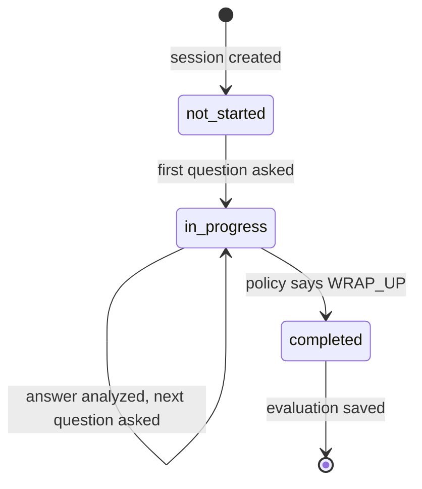
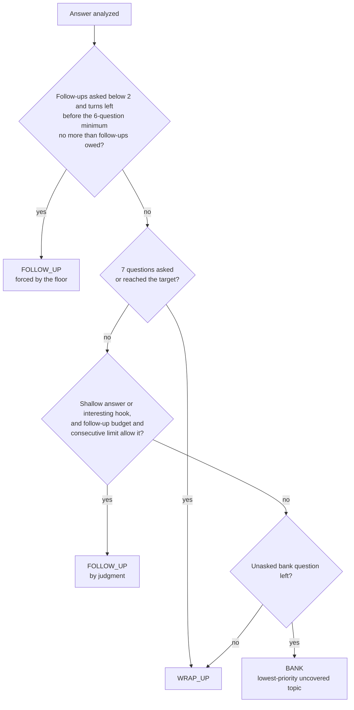
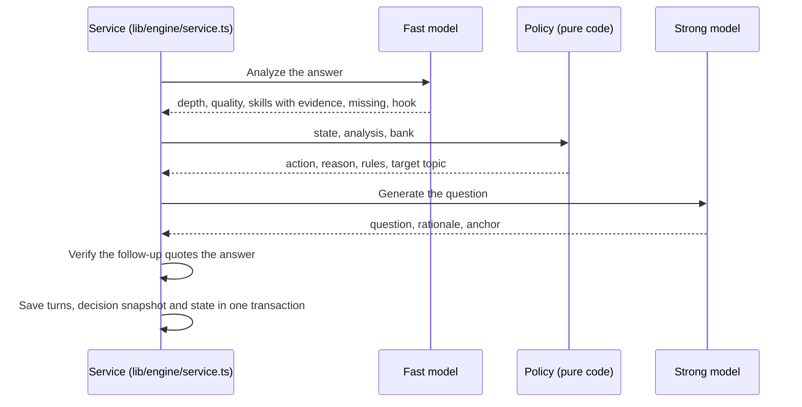
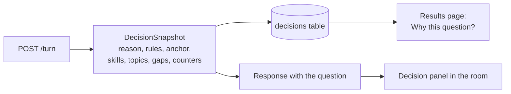

# Interview engine

[Back to the README](../README.md) · Related: [architecture](architecture.md), [data model](data-model.md), [testing](testing.md)

The server owns an explicit state machine. A candidate's answer goes in, and the next question (or the end of the interview) comes out. Code in `lib/engine` makes every decision, and the language model only writes the words and scores the result.

## Interview phases

The state itself (`InterviewState` in `lib/engine/types.ts`) holds the question counters, topics covered, gaps, skills detected with evidence, which bank questions were asked, and the quality of each answer. It is stored on the session, and a snapshot of the reasoning is stored for every interviewer turn.

## The policy step

`decideNext` in `lib/engine/policy.ts` is a pure function. Rules are checked in this order:

Defaults (`defaultPolicyConfig`): at least 6 questions, wrap up at 7, at least 2 follow-ups (a floor, so 1 is never enough), at most 3 follow-ups by judgment, and at most 2 follow-ups in a row by judgment.

- **The floor wins.** If follow-ups are still owed and only that many turns remain before the minimum, the next questions are follow-ups even when the answers were strong. It also beats the consecutive limit.
- **Never wrap up early.** `WRAP_UP` is only reachable once the floor is met, even past the target.
- **Bank choice.** The policy picks the uncovered topic with the lowest priority number and prefers the category (behavioral or technical) that was not just asked. If every topic is covered it revisits one, and it never repeats a bank question.

## The three model steps

- **Analyze** (`google/gemini-3.8-flash`): extracts skills with evidence, rates depth as shallow, adequate or strong, lists what was missing, and flags a hook worth probing. If it fails twice, a word-count heuristic takes over so the interview never stops.
- **Generate** (`anthropic/claude-sonnet-5.5`): bank questions are lightly rephrased to fit the conversation. Follow-ups must copy 3 to 12 words from the candidate's answer into an `anchor` and build on them.
- **Follow-ups always depend on the answer.** `followUpDependsOnAnswer` checks that the anchor really appears in the answer and that the question reuses its key words. If the model fails twice, a deterministic follow-up that quotes the answer is used instead.
- **Evaluate** (`lib/engine/steps.ts`): scores the full transcript against the role's competencies and returns JSON checked against a Zod schema. If the model fails, a transparent heuristic score is saved and labelled as such.

## Concurrency and idempotency

- Turn indexes are unique per session. Two simultaneous submissions of the same answer result in exactly one success and one `409 turn_conflict`.
- Starting an interview twice returns the same first question, and evaluating twice returns the saved result.

## The decision panel

Every interviewer turn stores a `DecisionSnapshot` (`lib/engine/types.ts`) in the `decisions` table, and the API returns it with each question, so the Interview Room can show the interviewer's reasoning live without extra requests.

The panel (`components/interview/decision-panel.tsx`) shows: why the question was chosen (the code-written reason, the rules that fired, whether the follow-up minimum forced it, and the quote a follow-up builds on), progress against the rules (questions asked, follow-ups against the required 2), skills detected with evidence and confidence, a checklist of the role's topics, and the gaps noticed. The results page shows the same reasoning for each question in the transcript.
