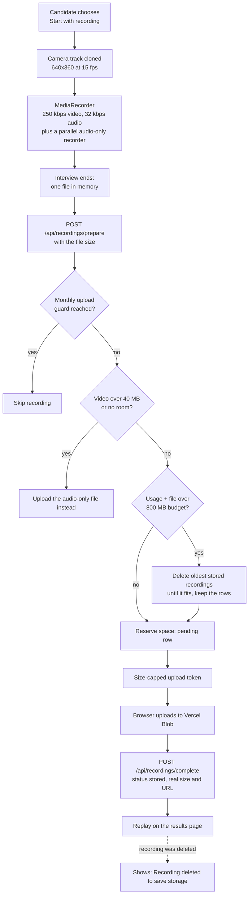

# Recording storage

[Back to the README](../README.md) · Related: [architecture](architecture.md), [data model](data-model.md)

Video mode can record the interview for replay. Recordings live in **Vercel Blob** (free tier), and the app keeps itself inside the free limits by compressing in the browser and deleting the oldest recordings. Transcripts and evaluations stay in Postgres and are never deleted by these rules.

## Rules

- **Compression happens at record time**, so no heavy re-encoding step is needed: a clone of the camera track limited to 640x360 at 15 fps, 250 kbps video and 32 kbps audio. The self-view keeps full quality. Preferred codecs are VP9, then VP8, then plain WebM, then MP4 (Safari).
- **One upload, at the end**, so the real size is known before the budget check. If the tab closes early, the recording is lost.
- **The server decides** (`lib/storage/budget.ts`, applied in `lib/storage/service.ts`). Usage comes from the `recordings` table (pending and stored rows), never from listing the Blob store. The decision runs in one transaction with an advisory lock, so concurrent uploads cannot overshoot the budget.
- **Pending rows older than 15 minutes** are treated as failed uploads and free their space.
- **Fail soft.** Any Blob error means "recording unavailable". The interview is never affected.
- **Camera is optional.** Without a camera the recording is audio only, and without consent nothing is recorded.

## Free-tier limits

| Limit               | Value  | How it is respected                                                     |
| ------------------- | ------ | ----------------------------------------------------------------------- |
| Vercel Blob storage | 1 GB   | `STORAGE_BUDGET_BYTES`, default 800 MB, oldest recordings deleted first |
| Largest video       | 40 MB  | `MAX_VIDEO_BYTES`, larger files fall back to audio only                 |
| Uploads per month   | 2,000  | `MAX_MONTHLY_UPLOADS`, default 1,500, then recording stops              |
| Blob data transfer  | 10 GB  | Small files, so roughly 250 full replays                                |
| Supabase database   | 500 MB | Only text and metadata are stored there                                 |

Going over the Blob limits does not bill, but Blob stops working for 30 days, which is why the guards sit well below them.

## Where it lives

| Piece                                             | File                                                                          |
| ------------------------------------------------- | ----------------------------------------------------------------------------- |
| Recorder settings (codecs, bitrates, constraints) | `lib/recorder/settings.ts`                                                    |
| Budget decision                                   | `lib/storage/budget.ts`                                                       |
| Prepare and complete logic                        | `lib/storage/service.ts`                                                      |
| Routes                                            | `app/api/recordings/prepare/route.ts`, `app/api/recordings/complete/route.ts` |
| Vercel Blob adapter                               | `lib/adapters/vercel-blob.ts`                                                 |
| Browser recorder                                  | `components/interview/use-recorder.ts`                                        |
| Video call layout and consent                     | `components/interview/video-room.tsx`, `components/interview/video-stage.tsx` |
