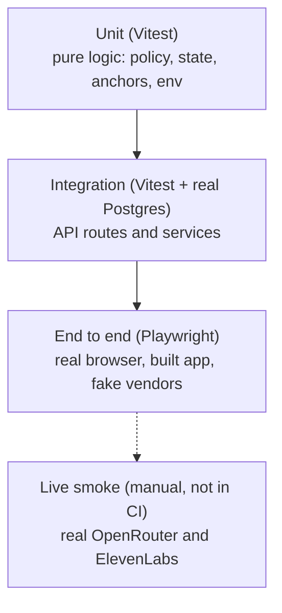

# Testing

[Back to the README](../README.md) · Related: [interview engine](interview-engine.md), [setup](setup.md)

Tests are written alongside each feature and run in CI on every push. Current counts: **190 unit and integration tests in 25 files** (Vitest), **14 end-to-end tests** (Playwright), plus live tests that need API keys.



| Level        | Command                                | What it covers                                                                                                                                                                              |
| ------------ | -------------------------------------- | ------------------------------------------------------------------------------------------------------------------------------------------------------------------------------------------- |
| Unit         | `npm run test:unit`                    | The policy step (6+ questions, 2+ follow-ups, no early wrap-up, with 2000 randomized interviews), state transitions, follow-up anchoring, env validation, seed ids.                         |
| Integration  | `npm run test:integration`             | A full interview through the services and through the HTTP route handlers against a real Postgres, concurrent submissions, error mapping, evaluation fallbacks.                             |
| End to end   | `npm run test:e2e`                     | A browser runs the job list, a whole interview, and the results page on a production build.                                                                                                 |
| Live smoke   | `npm run smoke`, `npm run smoke:voice` | Real model calls and a real ElevenLabs speech round trip. Needs API keys. Not run in CI.                                                                                                    |
| Live browser | `npm run test:live`                    | Real browser, real models and speech, simulated microphone (`tests/live/voice-browser.spec.ts`). The Agents variant `agent-browser.spec.ts` needs ngrok and is experimental. Not run in CI. |

The end-to-end tests use a fake transcriber that replays scripted answers, because headless browsers on some machines cannot capture audio. Tests that need the microphone permission path override `getUserMedia` instead.

Integration tests also cover the capacity queue (concurrent joins), recordings budget, history metrics, the demo-password helpers and the cron route. Playwright runs with `MAX_CONCURRENT_INTERVIEWS=50` so the queue does not interfere.

Other checks: `npm run lint`, `npm run typecheck`, `npm run format:check` and `npm run docs:check` (Mermaid syntax and links).

## How the fakes work

The engine and routes depend on interfaces in `lib/ports` (`LlmClient`, `SpeechTokenProvider`, `SpeechSynthesizer`, `BlobStore`, `Clock`). Each has a deterministic fake in `lib/adapters`.

- `FakeLlm` answers by task. Answers under 25 words are shallow, under 70 adequate, otherwise strong. An answer containing "because" or "however" produces a hook. Follow-ups quote the first words of the answer. Results are repeatable.
- With `USE_FAKES=1` the app wires every vendor to a fake while still using the real database. Playwright starts the built app this way.
- The database is never faked in integration and end-to-end tests. Both build a throwaway schema, apply the real migrations and seed it.

## Running locally

```bash
docker compose up -d --wait db   # Postgres for integration and e2e (started automatically if missing)
npm run test:unit
npm run test:integration
npx playwright install chromium  # once
npm run test:e2e
```

Integration and end-to-end tests drop and recreate the schema, so they refuse to run against any database that is not local. Set `TEST_DATABASE_URL` to use another local database.

## What LLM tests assert

Exact model text is never asserted. Tests check structure (output parses against the Zod schema), rules (follow-ups quote the previous answer, bank questions belong to the selected role) and invariants (turn order, counts).
