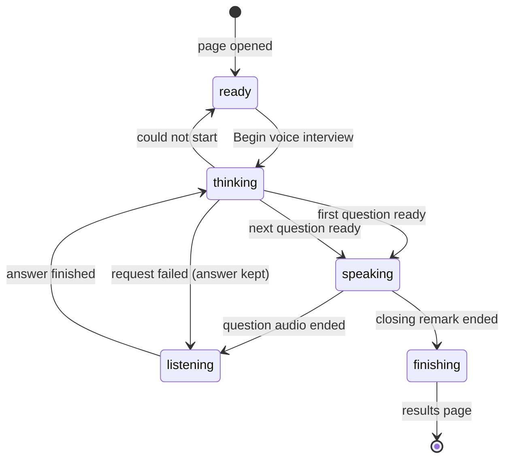
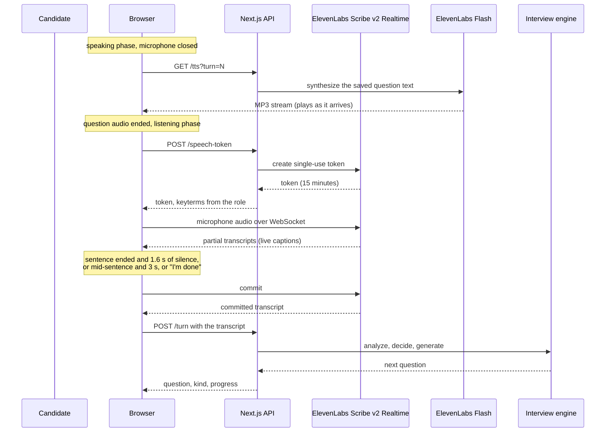

# Voice pipeline

[Back to the README](../README.md) · Related: [architecture](architecture.md), [interview engine](interview-engine.md), [testing](testing.md)

Voice mode uses **one provider, ElevenLabs**, for both directions: **Scribe v2 Realtime** turns the candidate's speech into live text, and **Flash** (`eleven_flash_v2_5`) speaks the interviewer's questions. The interview engine is unchanged: the browser sends a finished transcript and gets the next question back.

## What the candidate sees

The transitions are a pure reducer in `lib/voice/state-machine.ts`, so every path is unit tested.

## One answer, step by step (Option A)

## Design decisions

- **The API key never reaches the browser.** The server mints a single-use Scribe token for each answer, only for sessions that are `active`. Speech for the interviewer is streamed through our own `/tts` route, which only ever speaks the text of a saved interviewer turn, so it can't be used to synthesize arbitrary text.
- **The microphone is closed while the interviewer speaks.** The speech connection only exists during the listening phase, so the AI can never transcribe itself, and no audio is billed while it talks. A new connection costs about 0.7 s for the token, which overlaps with the end of the audio.
- **Manual commit, not short voice-activity timeouts.** Candidates pause to think, so we never let the service decide the answer is over after 200 to 400 ms. The browser decides, using `lib/voice/turn-assembler.ts`:

| Situation                                                | Answer ends after                                   |
| -------------------------------------------------------- | --------------------------------------------------- |
| Last sentence looks complete (ends with `.`, `!` or `?`) | 1.6 s of silence                                    |
| Stopped mid-sentence (probably thinking)                 | 3.0 s of silence                                    |
| "I'm done" button                                        | immediately                                         |
| Fewer than 3 words heard                                 | never auto-finishes, asks again if nothing was said |
| 3 minutes of speech                                      | forced end                                          |

- **Role vocabulary.** The job's `keyterms` (for example React, NPS, SQL) are sent to Scribe as `keyterms` to improve recognition. Scribe accepts up to 50 terms of at most 20 characters, and the server filters accordingly.
- **Always a way forward.** Microphone blocked or missing, speech service down, or interviewer voice unavailable: the room explains what happened and offers a typing box, and the interview continues. A failed submission keeps the candidate's words so they can resend.
- **Autoplay.** The "Begin voice interview" click unlocks one reused `<audio>` element, so later questions can play without further clicks.

## Latency

Measured with the real services through a real browser (`npm run test:live`), from the candidate's last word to the next question being spoken:

| Step                                                   | Time               |
| ------------------------------------------------------ | ------------------ |
| Silence wait (sentence end 1.6 s, mid-sentence 3 s)    | 1.6 to 3.0 s       |
| Commit round trip                                      | about 0.25 s       |
| Analyze, policy and question writing (run in parallel) | about 2.8 to 3.3 s |
| First audio byte of the spoken question                | about 0.5 s        |
| **Total**                                              | **about 5 to 6 s** |

The model steps overlap on purpose. While the answer is analyzed, the next bank question and a follow-up are already being written, and the one the policy picks is used. The opening question needs no model call at all. Switching between frontier and "flash" models changes this by only a few hundred milliseconds, so the structure matters more than the model.

## Option B: ElevenLabs Agents (parked)

The alternative, where ElevenLabs handles turn-taking and speaks while our engine stays the brain through an OpenAI-compatible Custom LLM route, is built but **not adopted**:

- `POST /api/agent-llm/chat/completions` streams the next question as server-sent events and checks a shared secret.
- `npm run agent:sync <public url>` creates or updates the agent and its workspace secret.
- `components/interview/agent-room.tsx` joins the agent from the browser. It is only used with `VOICE_TRANSPORT=agent` or `?transport=agent`.

Findings from a time-boxed spike through an ngrok tunnel: the agent, the signed URL and the room were created, but neither live attempt got a spoken answer through to our route (the tunnel's inspector showed no requests from ElevenLabs on the second try). Option A is verified end to end with the real services and its turn time is dominated by the deliberate silence wait, so Option B stays experimental. See the [plan](plan-ai-interviewer.md) Decision log.

## Verification

- Unit: turn assembly (`tests/unit/turn-assembler.test.ts`), the state machine, and the ElevenLabs adapters with a mocked `fetch`.
- Integration: the `/speech-token` and `/tts` routes.
- End to end (fake transcriber, fake vendors): a spoken interview ending by silence and by button, live captions, nothing heard, blocked microphone, failed voice, and the microphone staying closed while the AI speaks.
- Live (not in CI): `npm run smoke:voice` sends synthesized speech through the real Scribe service, and `npm run test:live` drives a real browser with the real services, feeding speech into the microphone.
